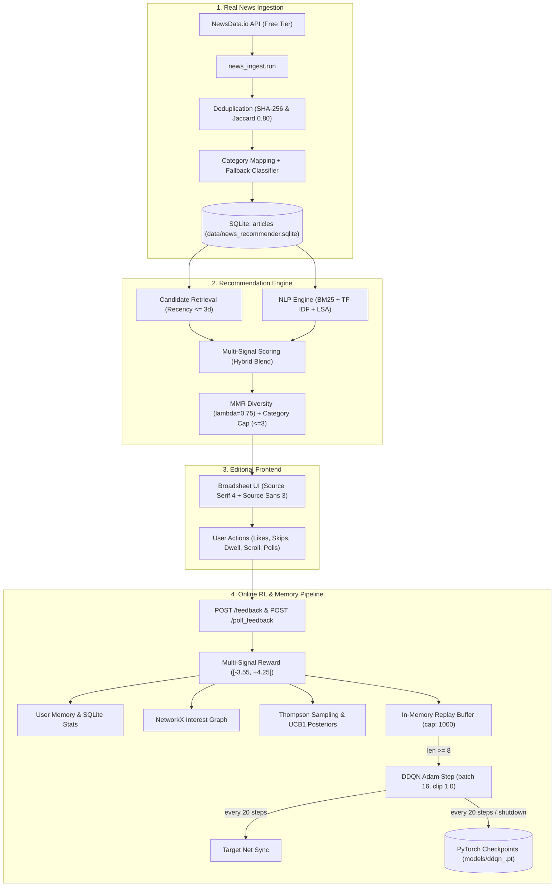

# NeuroFeed

NeuroFeed is a local-first news recommendation engine that ingests real-world news from NewsData.io and adapts its recommendations after every user interaction using a hybrid reinforcement learning (Dueling Double DQN) and contextual bandit (Thompson Sampling) architecture. It pairs an editorial broadsheet user interface adhering to a strict zero-icon design contract with an online training pipeline running locally against SQLite and PyTorch.

---

## 1. How It Works

The recommendation lifecycle follows a progressive user journey from cold start to personalized exploration:

1. **Onboarding**: A new user creates or selects a profile and declares initial category interests (such as Technology, Science, or Business) along with an optional baseline mood.
2. **Cold-Start Feed (`< 5` interactions)**: For a user's first 4 interactions, recommendations lean heavily on declared category preferences and current article trend velocity (`pref: 0.20`, `sim: 0.18`, `trend: 0.18`), while exploratory reinforcement learning and bandit weights remain minimal (`q: 0.08`, `ts: 0.00`).
3. **Feedback Learning**: Every user action provides explicit and implicit feedback signals:
   - Explicit likes (`L` key or "Useful") and dislikes (`D` key or "Not interested").
   - Implicit dwell time (reading longer than 6 seconds yields positive reward; quick skips under 2 seconds yield negative reward).
   - Scroll depth (scrolling past 70% yields positive reward; shallow skips under 15% yield penalty).
   - Quick poll cards embedded directly in the feed.
   - User interaction history, category preference counters, knowledge graph edges, and Thompson Sampling / UCB1 bandit statistics update immediately on every interaction starting from interaction 1.
   - Experience transitions `(s, a, r, s')` are appended to an in-memory replay buffer. Once 8 transitions accumulate, the DDQN executes an online gradient step on every interaction.
4. **Adaptive Feed (`>= 5` interactions)**: Once the user reaches 5 interactions, the scoring policy shifts to warm mode: DDQN predicted Q-values become the primary driver (`q: 0.20`), Thompson Sampling bandit exploration activates (`ts: 0.05`), reliance on static onboarding preferences drops to `0.09`, and graph affinity and mood signals refine candidate ranking.

---

## 2. Architecture Overview



The system comprises four tightly integrated subsystems:
1. **Ingestion Pipeline**: Periodically queries NewsData.io, deduplicates entries, assigns canonical categories, and persists normalized articles to SQLite.
2. **Recommendation Engine**: Retrieves candidate articles from SQLite, computes 7-component scoring blends, and applies Maximal Marginal Relevance (MMR) re-ranking with category saturation caps.
3. **Editorial Frontend**: A zero-icon broadsheet interface served by FastAPI that renders the feed, measures reading dwell and scroll depth, captures feedback, and submits telemetry.
4. **Online RL & Memory Pipeline**: Updates user preferences, graph memories, bandit posteriors, and Dueling Double DQN network weights with automatic model checkpointing.

---

## 3. Real News Ingestion Pipeline

NeuroFeed ingests live, real-world articles exclusively from [NewsData.io](https://newsdata.io/) into the local SQLite candidate pool (`is_live = 0`).

### NewsData.io Free Tier Characteristics
- **Endpoint**: `GET https://newsdata.io/api/1/latest` authenticated via the `apikey` query parameter.
- **Latency & Coverage**: The free plan provides articles with an approximate 12-hour publication delay; "latest" queries cover the trailing 48-hour window.
- **Content Scope**: The free tier provides headlines and brief description snippets only. Upstream article bodies are paywalled and are stripped out; readers click through to the canonical publisher URL for complete text.
- **Daily Quota Ceiling**: NewsData.io provides approximately 200 credits daily (1 credit returns up to 10 articles). The SQLite-backed `CreditTracker` enforces a hard ceiling of 180 credits per UTC day to prevent accidental exhaustion.
- **Rate Limiting & Pacing**: Requests are regulated by an automatic pacer enforcing a maximum of 28 requests per rolling 15-minute window and a minimum 1.0-second pause between consecutive requests, with exponential backoff on HTTP 429 or 5xx responses.
- **Local Disk Cache**: Raw JSON responses are cached in `final/data/cache/newsdata_raw/` with a 2-hour time-to-live (TTL), avoiding duplicate external network requests when re-running commands.

### Ingestion Features
- **Per-Category Targeting & Pagination**: Ingestion runs query each of the 10 internal application categories individually (`business`, `education`, `entertainment`, `health`, `lifestyle`, `politics`, `science`, `sports`, `technology`, `world`), paginating with the provider's `nextPage` token until the configured per-category target (`news_ingest_target_per_category`, default 40 articles) or credit limit is reached.
- **Deduplication**: Multi-stage deduplication combines an exact SHA-256 hash of the canonical URL and a token-level title Jaccard similarity check at a 0.80 threshold (`final/news_ingest/dedupe.py`).
- **Category Extraction & Quality Filtering**:
  - Explicit rule dictionary mapping provider categories (`category_mapping.json`).
  - Semantic cross-checks resolving RSS misclassifications (e.g., regex `STOCK_ANALYST_RE` reclassifies syndicated equity research incorrectly posted to sports blogs into `business`).
  - Fallback TF-IDF + Logistic Regression classifier trained on domain lexicons for unmapped or ambiguous articles.
  - Quality admission threshold: Candidate articles with a mapping confidence score below 0.50 are filtered out from the recommendation pool.
- **Retention & Recency**:
  - Feed recency window: The candidate pool prioritizes articles published within the last 3 days (`feed_recency_days = 3`). If fewer than 8 articles exist within this window, the query falls back gracefully to older catalog entries.
  - Pruning: Articles older than 14 days without user engagement are pruned (`max_article_age_days = 14`); articles that have received user interactions are retained indefinitely.
- **24-Hour Automatic Refresh**:
  - Evaluates elapsed time against `last_successful_ingest_at`.
  - Non-blocking startup trigger in FastAPI lifespan background executor pool.
  - Periodic background evaluation loop running every hour.
  - Clock anomaly handling: Shifts greater than 1 hour into the future are deferred safely; failed refreshes retain previous timestamps and back off without disrupting serving.
- **Empty State**: If the catalog contains 0 articles (for instance, on a fresh clone before running ingestion), the UI displays a clean broadsheet banner instructing the user to run `make ingest`, rather than generating synthetic fallback articles.

---

## 4. The Recommender

Candidate retrieval selects unread articles from SQLite matching `is_live = 0` and `mapping_confidence >= 0.50`, prioritizing items published within the 3-day recency window.

### Multi-Signal Scoring Function
Candidate articles are scored via a weighted combination of 7 distinct signals:

$$S(a) = w_q \cdot Q(s, \text{cat}(a)) + w_{sim} \cdot \text{Sim}(a, u) + w_{trend} \cdot \text{Trend}(a) + w_{pref} \cdot \text{Pref}(u, \text{cat}(a)) + w_{graph} \cdot \text{Graph}(a, u) + w_{ts} \cdot \text{TS}(\text{cat}(a)) + w_{mood} \cdot \text{Mood}(a, u)$$

The weights adapt across the cold-start boundary:

| Signal | Component Description | Cold Start (`< 5` interactions) | Warm Mode (`>= 5` interactions) |
|---|---|---|---|
| DDQN Q-value ($w_q$) | Dueling Double DQN category value estimate | 0.08 | 0.20 |
| NLP Similarity ($w_{sim}$) | BM25 + TF-IDF cosine similarity against user interaction history | 0.18 | 0.18 |
| Trending Score ($w_{trend}$) | Global engagement velocity combined with exponential recency decay | 0.18 | 0.11 |
| Category Preference ($w_{pref}$) | User declared onboarding preferences and accumulated interaction weight | 0.20 | 0.09 |
| Interest Graph ($w_{graph}$) | NetworkX entity and topic proximity score with temporal decay | 0.06 | 0.09 |
| Thompson Sampling ($w_{ts}$) | Sampled reward from Beta posterior distribution per category | 0.00 | 0.05 |
| Mood Affinity ($w_{mood}$) | Congruence score matching candidate sentiment with decayed user mood | 0.10 | 0.08 |
| **Sum** | | **0.80** | **0.80** |

### Diversity & Catalog Constraints
- **Maximal Marginal Relevance (MMR)**: Applied to top-ranked candidates with diversity trade-off $\lambda = 0.75$, balancing relevance against pairwise TF-IDF content similarity.
- **Category Saturation Cap**: A maximum of 3 articles from the same category are permitted within any single recommended batch of $k = 8$ articles.
- **Never-Repeat Rule**: Articles previously read, liked, disliked, or skipped by the active user are strictly excluded from subsequent candidate pools.

---

## 5. The Reinforcement Learning Model

NeuroFeed uses a Dueling Double Deep Q-Network (DDQN) paired with a Discounted Thompson Sampling contextual bandit.

### Network Architecture & Hyperparameters
- **State Space**: 11 continuous features:
  1. `attention_score`: Webcam gaze/eye openness or default dwell attention ($0.0 - 1.0$)
  2. `interaction_score`: Explicit feedback intensity
  3. `recent_activity`: Rolling event frequency
  4. `category_pref`: Normalized preference weight for candidate category
  5. `exploration_signal`: Category novelty and uncertainty score
  6. `graph_score`: Knowledge graph topic proximity
  7. `ts_reward`: Thompson Sampling expected posterior mean
  8. `time_sin`: Diurnal time encoding ($\sin(2\pi \cdot \text{hour} / 24)$)
  9. `time_cos`: Diurnal time encoding ($\cos(2\pi \cdot \text{hour} / 24)$)
  10. `session_like_rate`: Rolling ratio of positive to total interactions
  11. `mood_affinity`: Congruence between category sentiment and active user mood
- **Action Space**: 10 discrete actions corresponding to the canonical categories: `business`, `education`, `entertainment`, `health`, `lifestyle`, `politics`, `science`, `sports`, `technology`, `world`.
- **Dueling Architecture**: Separates state-value $V(s)$ and advantage $A(s, a)$ estimation streams:
  $$Q(s, a) = V(s) + \left(A(s, a) - \frac{1}{|A|} \sum_{a'} A(s, a')\right)$$
- **Double DQN Target Calculation**:
  $$Y_t = r + \gamma \, Q(s', \arg\max_{a'} Q(s', a'; \theta); \theta^-) (1 - \text{done})$$
- **Training Hyperparameters**:
  - Bellman discount factor: $\gamma = 0.9$ (configurable via `NEUROFEED_DDQN_GAMMA`)
  - Optimization: Adam optimizer with learning rate $1 \times 10^{-3}$ and gradient norm clipping at $1.0$
  - Experience replay capacity: 1,000 transitions
  - Warmup threshold: `ddqn_min_replay = 8`
  - Dynamic mini-batch size: $\min(16, \text{len(replay)})$
  - Exploration schedule: $\epsilon$ starts at 0.15, decaying by $\times 0.995$ per gradient step down to a minimum of 0.03
  - Target network synchronization: Weights copy from primary network $\theta$ to target network $\theta^-$ every 20 gradient steps
  - Model checkpointing: Asynchronous background saves every 20 steps via a 4-worker thread pool, plus a synchronous `flush_save()` on process shutdown to `final/models/ddqn_<user_id>.pt`
  - Per-user isolation: Each registered user has an isolated agent instance and checkpoint file

### Immediate vs. Delayed Updates
When an interaction occurs:
- **Immediate components (interaction 1 onward)**: User interaction history, SQLite category statistics, NetworkX graph edges, and Thompson Sampling Beta distributions $(\alpha, \beta)$ (with decay factor 0.995) update immediately. UCB1 visit counts and values also update immediately for diagnostic tracking.
- **Delayed DDQN training (interactions 1 to 7)**: Transitions $(s, a, r, s')$ are stored in the replay buffer. While `len(replay) < 8`, gradient steps return `None`.
- **Online DDQN training (interaction 8 onward)**: Once 8 transitions have accumulated, every interaction triggers a synchronous mini-batch update, decaying $\epsilon$ and updating loss telemetry.

### Replay Buffer Lifecycle Across Restarts
The experience replay buffer resides purely in process memory and is **not** written to disk. When the FastAPI application restarts, the replay buffer size resets to 0, requiring 8 new user interactions before gradient updates resume. Checkpointed primary network weights, optimizer states, step counts, epsilon values, and bandit posteriors are fully restored from disk.

### Reward Function
Feedback yields a scalar reward bounded approximately within $[-3.55, +4.25]$:
- Explicit like: $+2.0$; explicit dislike: $-2.0$
- Dwell time: $+1.2$ for reads $> 6\text{s}$; $-1.2$ for skips $< 2\text{s}$
- Content similarity: $+0.5 \times \text{NLP similarity}$
- Scroll depth: $+0.4$ for deep reading ($> 70\%$); $-0.2$ for shallow skips ($< 15\%$)
- Mood alignment: $\pm 0.15$ based on emotional congruence
- Poll feedback: $+1.0$ for positive affinity, $-1.0$ for negative affinity

### Verified Learning Results (`make verify-rl`)
Running `make verify-rl` executes an automated 60-interaction proof against an isolated temporary database (simulating a technology enthusiast who likes technology and dislikes business):

| Metric | Measured Value |
|---|---|
| Warmup duration | Interactions 1 to 7 (step: None, loss: None) |
| First gradient step | Interaction 8 (batch size: 8, loss: 0.7225, $\epsilon$: 0.1492) |
| Target network sync points | Step 20 (interaction 27) and Step 40 (interaction 47) |
| Total gradient steps fired | 53 gradient steps (interactions 8 through 60) |
| Final epsilon | 0.1150 (initial: 0.1500) |
| Final training loss | 0.1825 |
| Final $Q(\text{technology})$ | $+6.5111$ |
| Final $Q(\text{business})$ | $+2.2817$ |
| Final Q-value gap | $+4.2294$ in favor of technology |
| Checkpoint reload weight delta | $0.00000000$ (exact byte and weight recovery) |
| Final recommendation mix | 20/20 technology (100%), 0/20 business (0%) |

---

## 6. Frontend Architecture & Zero-Icon Contract

The user interface is designed as an editorial broadsheet newspaper prioritizing typographic hierarchy and reading focus over decorative clutter.

### Design Principles
- **Typography**: Google Fonts `Source Serif 4` for headlines, brand masthead, and section kickers; `Source Sans 3` for body text, metadata, and controls.
- **Strict Zero-Icon Contract**: The frontend contains zero `<svg>` elements, zero icon fonts, zero emoji, and zero directional symbols used as icons (`→`, `↗`, `×`, `⏱`, `🎯`). All interactive controls use clear, unambiguous text ("Useful", "Not interested", "Next article", "Read full article", "Close").
- **Automated Verification**: Enforced at test time by `scripts/check_no_icons.py`, which scans all frontend HTML, CSS, and JavaScript files during `make test` and fails the build if any icon pattern is detected.
- **Themes**: Supports light and dark modes via CSS custom properties. Defaults to system `prefers-color-scheme` with a manual text toggle ("Dark mode" / "Light mode") persisting to `localStorage['nf-theme']`.
- **Keyboard Navigation**:
  - `L`: Mark current article useful (like)
  - `D`: Mark current article not interested (dislike)
  - `N`: Advance to next article

### Interface Screenshots
The editorial interface can be viewed in both themes:

- **Light Mode Feed**: [docs/screenshots/feed_light_desktop.png](docs/screenshots/feed_light_desktop.png)
- **Dark Mode Feed**: [docs/screenshots/feed_dark_desktop.png](docs/screenshots/feed_dark_desktop.png)
- **Article Reading Modal**: [docs/screenshots/modal_light.png](docs/screenshots/modal_light.png)
- **Onboarding Screen**: [docs/screenshots/onboarding_desktop.png](docs/screenshots/onboarding_desktop.png)

---

## 7. Optional Features

### Webcam Attention Tracking
- Tracks eye aspect ratio, gaze direction, and head orientation via OpenCV and MediaPipe FaceMesh to measure reading focus.
- **Privacy & Execution**: Runs entirely on the local machine within process memory. Video frames are never written to disk or transmitted over any network.
- **Disabled by Default**: Configured via `NEUROFEED_ENABLE_WEBCAM_ATTENTION=false`. When disabled or when no camera device is present, the system falls back gracefully to a neutral attention score of 0.5 without logging errors.

### Live News Ticker
- Connects optionally to NewsAPI.org (`NEUROFEED_NEWS_API_KEY`) to display a real-time breaking news bulletin.
- **Quarantine**: Live news articles are stored with `is_live = 1` in SQLite. They are quarantined strictly to the UI ticker bar and are excluded from recommendation candidate pools, candidate scoring, and reinforcement learning updates.

---

## 8. Setup and Running

### Prerequisites
- macOS or Linux
- Python 3.12 (pinned to `3.12.6` in `.python-version`)
- SQLite 3

### Environment Configuration
1. Clone the repository:
   ```bash
   git clone https://github.com/NematSachdeva/news-rl.git
   cd news-rl
   ```
2. Create your local environment file:
   ```bash
   cp .env.example .env
   ```
3. Add your NewsData.io API key to `.env`:
   ```env
   NEWSDATA_API_KEY=your_newsdata_api_key_here
   ```
   > **Important**: Never commit `.env` or expose API keys. The `.gitignore` file excludes `.env`, `*.sqlite`, and checkpoint files.

### Commands

| Command | Description |
|---|---|
| `make setup` | Creates virtualenv `.venv` and installs locked dependencies |
| `make ingest` | Ingests real news respecting the 24-hour refresh interval and daily quota |
| `make ingest-force` | Bypasses the 24-hour interval check to force an immediate ingestion run |
| `make run` | Starts the FastAPI application at http://127.0.0.1:8000 |
| `make test` | Executes the complete test suite (146 tests) and the zero-icon scan |
| `make verify-rl` | Runs the 60-interaction online RL training proof against an isolated database |
| `make eval` | Runs the offline simulated-user recommendation evaluation harness |
| `make check-icons` | Scans all frontend files for forbidden icons, emoji, and SVG elements |

Alternatively, `./run.sh` provides shell wrapper commands:
```bash
./run.sh setup
./run.sh ingest
./run.sh run
./run.sh test
```

### Application URLs
- **Web Feed**: [http://127.0.0.1:8000/app/](http://127.0.0.1:8000/app/)
- **Interactive API Documentation (Swagger)**: [http://127.0.0.1:8000/docs](http://127.0.0.1:8000/docs)
- **Health Check**: [http://127.0.0.1:8000/health](http://127.0.0.1:8000/health)

---

## 9. Configuration Reference

All settings can be specified via environment variables or the root `.env` file:

| Variable | Default | Description |
|---|---|---|
| `NEUROFEED_ENV` | `development` | Runtime environment mode (`development`, `production`, `test`) |
| `NEUROFEED_DB_PATH` | `final/data/news_recommender.sqlite` | SQLite database file path for articles, interactions, and graph edges |
| `NEUROFEED_AUTH_DB_PATH` | `final/data/auth.sqlite` | SQLite database path for user profiles and authentication |
| `NEUROFEED_MODEL_DIR` | `final/models` | Storage directory for PyTorch DDQN checkpoint files (`*.pt`) |
| `NEUROFEED_ENABLE_WEBCAM_ATTENTION` | `false` | Enable OpenCV + MediaPipe webcam attention tracking |
| `NEUROFEED_COLD_START_INTERACTION_THRESHOLD` | `5` | Interaction count boundary before RL Q-values become dominant |
| `NEUROFEED_MMR_LAMBDA` | `0.75` | Diversity trade-off factor for MMR re-ranking (1.0 = pure relevance) |
| `NEWSDATA_API_KEY` | `""` | NewsData.io API key for real news ingestion |
| `NEUROFEED_NEWSDATA_DAILY_CREDIT_LIMIT` | `180` | Daily API credit limit ceiling (below 200 free-plan limit) |
| `NEUROFEED_NEWS_INGEST_CATEGORIES` | `business,education,entertainment,health,lifestyle,politics,science,sports,technology,world,top` | Ingested NewsData.io category categories |
| `NEUROFEED_NEWS_INGEST_COUNTRIES` | `in,us,gb` | Target country codes for ingestion queries |
| `NEUROFEED_NEWS_INGEST_TARGET_PER_CATEGORY` | `40` | Ingestion target article count per internal category |
| `NEUROFEED_NEWS_CATEGORY_MIN_CONFIDENCE` | `0.50` | Minimum mapping confidence required to admit an article into candidate pool |
| `NEUROFEED_REFRESH_INTERVAL_HOURS` | `24.0` | Minimum elapsed hours before triggering an automatic news refresh |
| `NEUROFEED_FEED_RECENCY_DAYS` | `3` | Preferred recency window for candidate retrieval |
| `NEUROFEED_MAX_ARTICLE_AGE_DAYS` | `14` | Catalog retention period before pruning unengaged articles |
| `NEUROFEED_DDQN_MIN_REPLAY` | `8` | Minimum replay buffer samples required before gradient steps fire |
| `NEUROFEED_DDQN_GAMMA` | `0.9` | Bellman discount factor for Double DQN updates |
| `NEUROFEED_NEWS_API_KEY` | `""` | NewsAPI.org API key for optional live breaking ticker |

---

## 10. API Overview

| Endpoint | Method | Description |
|---|---|---|
| `/onboard` | `POST` | Registers or configures a user profile with starting category preferences and mood |
| `/recommend` | `GET` | Returns a personalized batch of recommendations scored by the hybrid pipeline |
| `/feedback` | `POST` | Logs user interaction (likes, dislikes, dwell time, scroll depth) and trains RL |
| `/poll_feedback` | `POST` | Ingests poll responses to calibrate category preferences and update bandit states |
| `/news/status` | `GET` | Returns news catalog metrics, provider connectivity, and credit consumption |
| `/news/ingest` | `POST` | Triggers a news ingestion run from the configured provider |
| `/news/live` | `GET` | Fetches optional breaking headlines for the live ticker (`is_live = 1`) |
| `/rl/metrics/{user_id}` | `GET` | Developer telemetry exposing DDQN loss, epsilon, step, replay size, and bandit posteriors |
| `/categories` | `GET` | Lists supported news categories |
| `/users` | `GET` | Lists existing user IDs for session switching |
| `/health` | `GET` | Server health check verifying database and model directory accessibility |
| `/docs` | `GET` | Interactive Swagger UI documentation |

---

## 11. Testing and Verification

### Pytest Suite
The automated test suite contains 146 tests spanning:
- API endpoint contracts and error handling
- Real news provider ingestion, caching, and credit tracking
- URL hashing and title Jaccard deduplication
- Rule-based category mapping, regex semantic cross-checks, and TF-IDF fallback classification
- Reading history, user memory, and NetworkX interest graph decay
- Recommender candidate scoring, cold-start transitions, and MMR diversity
- Discounted Thompson Sampling and UCB1 bandit updates
- DDQN replay buffer warmup decoupling and gradient update boundaries
- 24-hour refresh scheduling and anomaly handling
- Strict zero-icon frontend enforcement

Run tests with:
```bash
make test
```

### RL Online Training Verification (`make verify-rl`)
The verification script (`scripts/verify_rl_training.py`) simulates 60 controlled interactions against a temporary SQLite database, verifying that:
1. Steps 1–7 do not fire gradient updates (`train_step` returns `None`).
2. Step 8 initiates training with dynamic batch sizing.
3. Target network updates synchronize at steps 20 and 40.
4. Q-values diverge in favor of preferred categories ($Q(\text{tech}) > Q(\text{biz})$ by $+4.22$).
5. Checkpoint saving and reload recover model weights with zero numerical drift.

### Zero-Icon Verification (`make check-icons`)
The static scanner (`scripts/check_no_icons.py`) inspects every file in `final/frontend/` for emoji characters, SVG tags, icon-font classes, icon library imports, and directional symbols, ensuring the broadsheet visual contract remains intact.

### Evaluation Harness (`make eval`)
The simulation harness (`final/evaluation.py`) runs 20 simulated users across 20 recommendation rounds ($k = 8$) against the real catalog to measure ranking performance without regressions:
- **Precision@K**: $0.561$
- **NDCG@K**: $0.820$
- **Category Diversity**: $0.560$
- **Catalog Coverage**: $0.174$
- **Precision@K (early rounds 1–5)**: $0.605$
- **Precision@K (late rounds 16–20)**: $0.437$

---

## 12. Limitations and Honest Notes

- **Upstream Free-Plan Latency & Snippets**: NewsData.io's free tier provides articles on an approximate 12-hour delay. Upstream full-text article bodies are paywalled; NeuroFeed displays article titles and description snippets, linking to the publisher's website for full reading.
- **Simulated-User Evaluation**: All quantitative evaluation metrics are derived from automated simulated-user sessions (`evaluation.py`). No formal human cohort study has been performed.
- **Category Mapping Heuristics**: While regex rules (`STOCK_ANALYST_RE`) catch frequent syndicated errors, ambiguous articles that score above the 0.50 confidence threshold may occasionally be mapped to adjacent categories.
- **UCB1 Role**: UCB1 visit counts and values are updated on every interaction and surfaced via `GET /rl/metrics/{user_id}` for diagnostic comparison, but are **not** currently used in candidate ranking (which blends DDQN Q-values and Thompson Sampling).
- **Abrupt Cold-Start Switch**: The recommender switches from cold-start weights to warm-mode weights via a hard threshold at 5 interactions rather than a smooth continuous transition.
- **In-Memory Replay Buffer**: The replay buffer is held purely in RAM. If the application server restarts, the buffer resets to 0 samples, requiring 8 new user interactions before gradient updates resume (though checkpointed weights and bandit posteriors are preserved).
- **Finite Catalog Exhaustion**: In multi-round evaluation (20 users x 20 rounds with $k=8$), each user requests 160 articles under the never-repeat rule. In a finite catalog of ~350 articles distributed across 10 categories, preferred categories (containing ~40 articles) are fully exhausted after several rounds, causing late-round Precision@K to drop ($0.605 \rightarrow 0.437$). This reflects finite catalog exhaustion under never-repeat filtering rather than policy degradation.

---

## 13. Roadmap

- **Secondary News Provider**: Add support for secondary news APIs (such as GNews or Currents) to expand catalog depth and improve per-category density.
- **Smooth Policy Blending**: Replace the hard switch at 5 interactions with a sigmoid or logistic decay function to transition gradually from declared preferences to learned Q-values.
- **Persistent Replay Buffer**: Optionally serialize the experience replay buffer to disk alongside PyTorch model checkpoints, allowing gradient updates to resume immediately upon restart.
- **Deployment Infrastructure**: The `deploy/` directory contains configuration files for Docker, Docker Compose, Render, Netlify, and Vercel. These are preserved for future deployment work and are not in active use for local development.

---

## 14. Attribution and License

NeuroFeed is based on the open-source base project [News-Recommender](https://github.com/Dracula-5/News-Recommender) by Dheeraj.

*Note: No formal open-source license file currently exists in this repository.*
