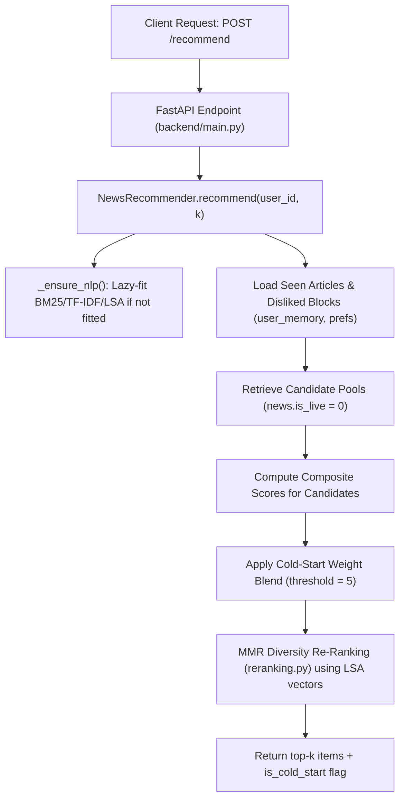
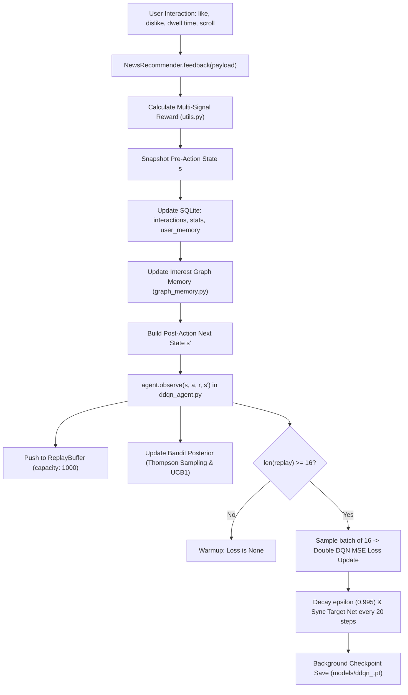

# NeuroFeed Architecture & Data Flow

This document details the request paths, learning loops, and data structures in NeuroFeed.

---

## 1. Category Vocabulary & Policy Dimensions

- **Category Set (10 categories, alphabetical)**:
  `['business', 'education', 'entertainment', 'health', 'lifestyle', 'politics', 'science', 'sports', 'technology', 'world']`
- **DDQN Action Space**:
  $A = 10$, mapping index $0 \dots 9$ to the categories above. The Dueling DQN advantage stream outputs 10 logits:
  $$Q(s, a) = V(s) + \left(A(s, a) - \frac{1}{|A|}\sum_{a'} A(s, a')\right)$$
- **State Vector Dimension**:
  $S \in \mathbb{R}^{11}$:
  `[attention_score, interaction_score, recency_liked_boost, category_pref, exploration_signal, graph_score, ts_expected_reward, sin(time), cos(time), session_like_rate, mood_affinity]`

> [!IMPORTANT]
> The DDQN network input/output dimensions and saved checkpoints (`models/ddqn_<user_id>.pt`) strictly depend on this 10-category vocabulary. Altering or reordering categories invalidates existing checkpoints.

---

## 2. Request Flow: `POST /recommend`

1. **Candidate Retrieval**:
   - Excludes articles already in `user_memory` (seen/feedback given).
   - Excludes categories blocked due to $\ge 2$ consecutive dislikes.
   - Filters `news.is_live = 0` (keeps the catalog clean from ephemeral live bulletin rows).
2. **Candidate Scoring**:
   $$\text{score} = \text{clamp}\left(w_q \cdot \sigma(q) + w_{\text{sim}} \cdot \text{sim} + w_{\text{trend}} \cdot \text{trend} + w_{\text{pref}} \cdot \text{pref} + w_{\text{graph}} \cdot g + w_{\text{ts}} \cdot \text{ts} + w_{\text{mood}} \cdot m + \text{att\_boost} - \text{saturation}\right)$$
3. **Cold-Start Blending**:
   - `interactions < 5`: Declared preferences and trending dominate (`pref: 0.20`, `trend: 0.18`, `sim: 0.18`, `q: 0.08`, `ts: 0.00`).
   - `interactions >= 5`: DDQN Q-values take primary weight (`q: 0.20`, `sim: 0.18`, `trend: 0.11`, `pref: 0.09`, `ts: 0.05`).
4. **MMR Re-Ranking**:
   Balances candidate relevance against novelty across 64-dimensional LSA content vectors ($\lambda = 0.75$).

---

## 3. Feedback Flow & Online RL: `POST /feedback`

### Multi-Signal Reward Formula
$$\text{Reward} = \pm 2.0_{\text{like/dislike}} + \Delta t_{\text{dwell}} + 0.50 \cdot \text{sim} + \Delta_{\text{scroll}} \pm 0.30 \cdot (\text{mood\_congruence} - 0.5)$$
- **Dwell Time**: $+1.2$ ($> 6\text{s}$), $-1.2$ ($< 2\text{s}$).
- **Scroll Depth**: $+0.40$ ($> 70\%$), $-0.20$ ($< 15\%$ on skip).
- **Resulting Range**: Approximately $[-3.55, +4.25]$.

### Experience Replay & Double DQN
- Transitions: $(s, a, r, s', \text{done})$.
- Target calculation:
  $$Y_t = r + \gamma \, Q(s', \arg\max_{a'} Q(s', a'; \theta); \theta^-)$$
- Updates the primary network $\theta$ via Adam optimizer with gradient clipping at $1.0$, periodically updating target network $\theta^-$ every 20 steps.

---

## 4. Interaction Paths & Persistence Lifecycle

### Full Feedback (`POST /feedback`)
1. Pre-state $s$ is captured before database mutations (using `graph_scores_before`, previous session like rates, and current Thompson Sampling expectations).
2. Interaction and graph edges are recorded in SQLite.
3. Post-state $s'$ is computed with updated graph scores and preferences.
4. `agent.observe(s, category, reward, s', done=False, liked=bool(liked))` executes:
   - Pushes transition to `ReplayBuffer(1000)`.
   - Updates Thompson Sampling Beta distributions ($(\alpha, \beta)$ updated with decay $0.995$) and UCB1 visit counts/values.
   - For interactions 1–15 (warmup), `train_step()` returns `None`.
   - At interaction 16 and beyond, each feedback executes a synchronous mini-batch gradient step on 16 sampled transitions, updates `last_loss`, decrements $\epsilon$, and every 20 steps syncs target network weights.

### Poll Feedback (`POST /poll_feedback`)
- Previously, poll feedback only mutated category preference values in SQLite without notifying the RL agent.
- **Fixed path**: Poll feedback snapshots pre-state $s$, writes the preference delta ($\pm 0.10 / -0.12$), re-reads post-state $s'$, and calls `agent.observe(s, category, reward=\pm 1.0, s')`, ensuring poll engagement also drives DDQN replay and bandit adaptation.

### Checkpoint Persistence & Shutdown Flush
- **Periodic Saves**: Triggered asynchronously every `save_interval = 20` gradient steps via a shared, bounded `ThreadPoolExecutor(max_workers=4)`.
- **Shutdown Flush**: On application termination (Ctrl-C, SIGTERM, FastAPI lifespan shutdown), `flush_save()` is called on all active agents, executing a synchronous write directly to `models/ddqn_<user_id>.pt` to prevent loss of up to 19 unpersisted gradient steps.

### Developer Diagnostics Endpoint
- `GET /rl/metrics/{user_id}` exposes:
  `user_id`, `step`, `epsilon`, `replay_size`, `warmup_remaining`, `last_loss`, `ddqn_weight`, `hybrid_step`, `categories`, `ts_confidence`, `ucb_values`, and `ucb_counts`.

---

## 5. Frontend Editorial Architecture & Zero-Icon Contract

- **Typography Stack**: Google Fonts `Source Serif 4` (headlines, brand, kicker) + `Source Sans 3` (body, metadata, controls, buttons).
- **Theme Variables**: CSS custom properties for `--bg`, `--paper`, `--border`, `--border2`, `--ink`, `--ink2`, `--muted`, and `--red` accent.
- **Color Scheme Support**:
  - Dark mode (`--bg: #0e0e0d`, `--paper: #1a1a18`, `--ink: #f1efe8`)
  - Warm light mode (`--bg: #FAF9F6`, `--paper: #FFFFFF`, `--ink: #1A1917`)
  - Auto-detected via `prefers-color-scheme` with manual toggle button (`#themeToggle`) persisting in `localStorage['nf-theme']`.
- **Zero-Icon Policy**: No `<svg>` tags, no icon fonts, no emoji, and no directional symbols used as icons (`→`, `↗`, `×`, `⏱`, `🎯`, `🔥`, `🗞️`). Verified automatically by `scripts/check_no_icons.py` during `make test`.

